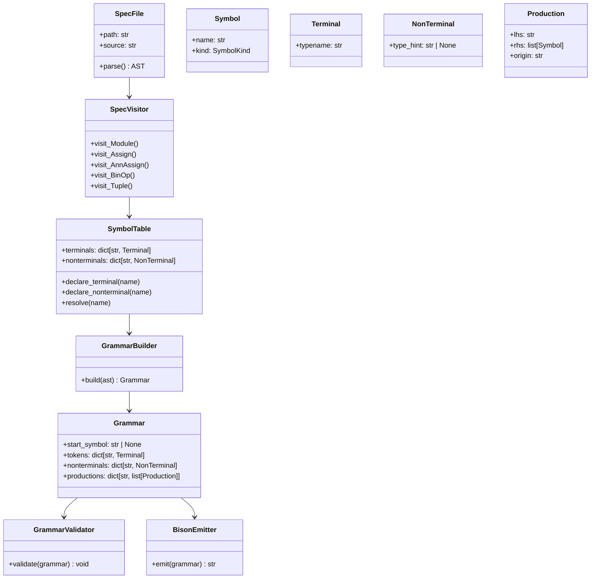

# metaox design notes

## Goal

The goal of this library is to let a Python-valid grammar spec file describe the grammar, then have `metaox` parse that spec and construct a logical grammar representation that can later be converted into Bison grammar text and eventually generated C code.

This is not a custom grammar language parser. It is a Python AST-driven grammar interpreter.

---

## Core idea

The file `spec.mo` is still valid Python syntax, but it follows a constrained semantic contract:

- `A: term` means a terminal declaration
- `A = ...` means a nonterminal definition
- `|` means an alternative
- `(A, B, C)` means a sequence
- `list[T]` means repetition or list-style production
- bare names in the rule body are grammar symbols

So the file is parsed by Python `ast.parse()`, and then `metaox` interprets the AST to build a grammar model.

---

## Why this is the right approach

This keeps the file:

- valid Python
- easy to read
- easy to type
- easy to validate with standard Python tooling

It avoids inventing a second grammar language and a second parser just to read the specification file.

The missing layer is not syntax parsing; it is semantic interpretation of the Python AST into a proper grammar representation.

---

## What the current implementation already has

The codebase already has the right high-level structure:

- [lib/parser/tools/metaox/types.py](../metaox/types.py) defines low-level grammar symbols such as `term`, `nterm`, `rule`, `rule_set`, and `sub_rule`
- [lib/parser/tools/metaox/visitor/term_nterm_creator.py](../metaox/visitor/term_nterm_creator.py) collects terminal and nonterminal declarations
- [lib/parser/tools/metaox/visitor/rules.py](../metaox/visitor/rules.py) tries to recover rule dependencies and production structure
- [lib/parser/tools/gen_bison.py](../gen_bison.py) is the entry point that parses the file and launches the AST visitors

This is a good starting point, but the current implementation is only building a loose dependency graph. It is not yet a proper grammar IR.

---

## Missing piece: a grammar IR

To satisfy the intended design, `metaox` needs to build a logical grammar model before Bison text output.

The recommended IR is:

### Symbol

```python
class Symbol:
    name: str
    kind: "terminal" | "nonterminal"
```

### Terminal

```python
class Terminal(Symbol):
    typename: str = "Token"
```

### NonTerminal

```python
class NonTerminal(Symbol):
    type_hint: str | None
```

### Production

```python
class Production:
    lhs: str
    rhs: list[Symbol]
    source: str  # optional location / source expression
```

### Grammar

```python
class Grammar:
    start_symbol: str | None
    tokens: dict[str, Terminal]
    nonterminals: dict[str, NonTerminal]
    productions: dict[str, list[Production]]
```

This is the logical representation that can later be converted to Bison grammar text.

---

## The processing pipeline

The correct pipeline is:

1. Parse the Python source with `ast.parse()`
2. Collect symbols and declarations
3. Build the grammar IR
4. Validate the grammar
5. Emit Bison-friendly output later

This pipeline is separate from code generation. It should not yet produce C code.

---

## What validation should include

Before converting to Bison, the library should validate:

- all referenced symbols are declared
- terminal and nonterminal names are unique
- no illegal mixing of terminals/nonterminals in a sequence
- recursive rules are legal
- empty productions are handled intentionally
- list-style productions are normalized correctly
- the start symbol exists

---

## Recommended architecture

A clean package layout would look like this:

```text
metaox/
  __init__.py
  types.py
  spec_parser.py
  symbol_table.py
  grammar_builder.py
  validator.py
  bison_emitter.py
```

The responsibilities would be:

- `spec_parser.py`: parse the Python file with `ast`
- `symbol_table.py`: collect and resolve terminals/nonterminals
- `grammar_builder.py`: convert AST into `Grammar`
- `validator.py`: validate the grammar before serialization
- `bison_emitter.py`: emit Bison grammar text

---

## UML diagram



---

## What is missing in the current code

The current implementation in [lib/parser/tools/metaox/visitor/rules.py](../metaox/visitor/rules.py) is doing dependency analysis, not grammar construction.

It lacks:

- a proper production model
- symbol resolution by kind
- grammar validation
- a grammar IR
- a distinct Bison serialization stage

That is the main gap between “the file parses” and “the grammar is correctly represented for later code generation.”

---

## Bottom line

Your intent is valid and well-structured:

- `spec.mo` is a grammar description file
- `metaox` is a grammar-spec interpreter
- the logical representation is the intermediate layer
- Bison output is a later serialization step

The right continuation is to implement the grammar IR and validation stage, not to invent a completely new grammar syntax.

That will preserve the Python-valid DSL and support the planned generation pipeline cleanly.
